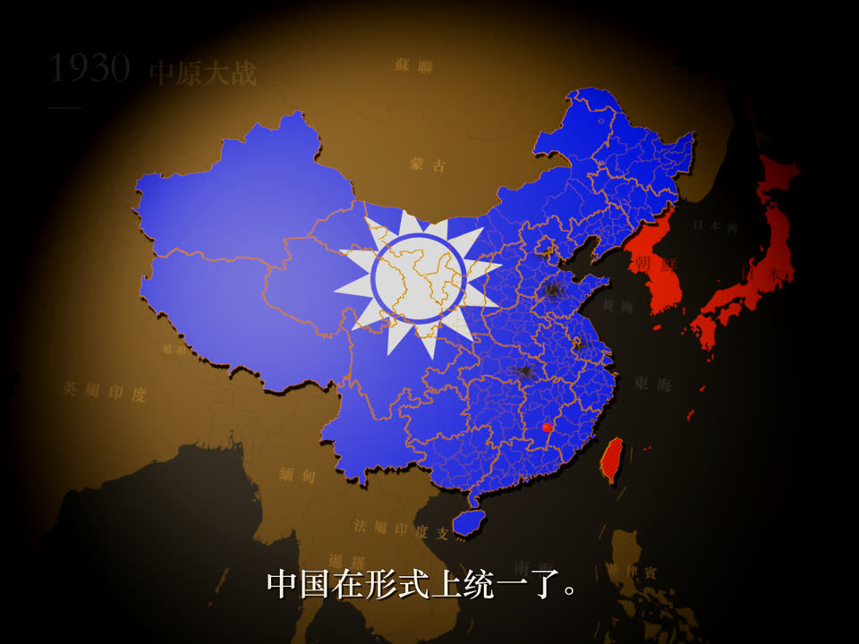
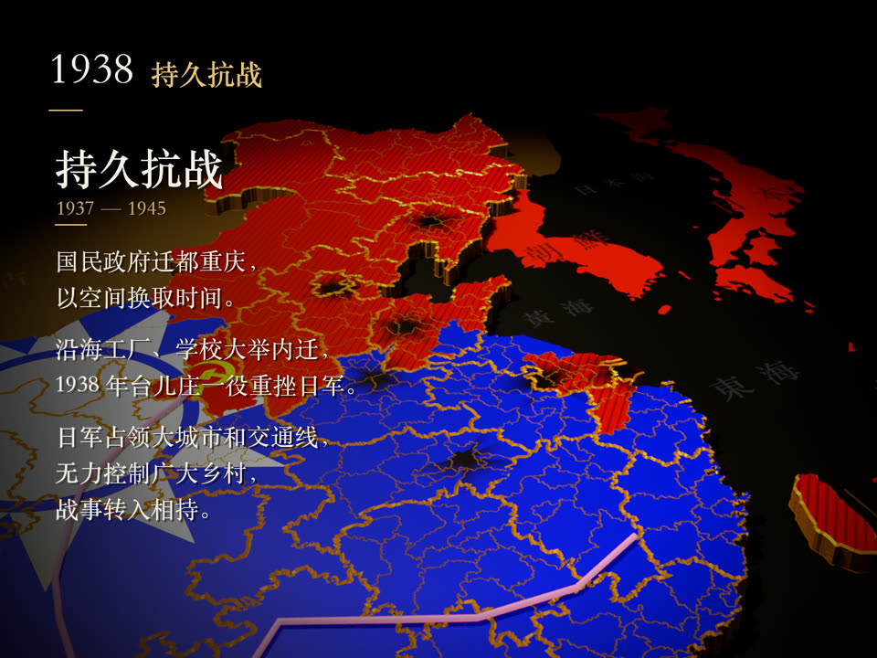
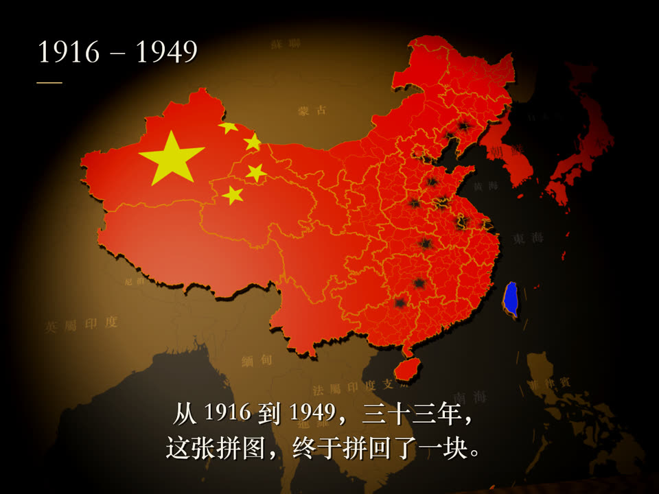
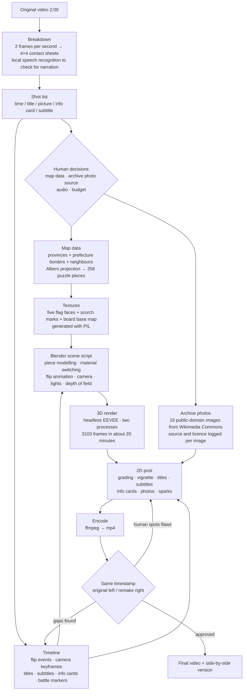

# 01 · Remaking the 3D jigsaw-puzzle map "中华民族的救亡图存"

[中文](README.md) | English

A 2-minute-09 Blender history video built around a jigsaw-puzzle map of China, rebuilt shot by shot by having Claude Code write the code.

- Original: <https://www.douyin.com/video/7703025441100337256> (published 2026-11-01, 720×540 landscape, 400k+ likes)
- The idea belongs to the original creator: the map is a boxed physical jigsaw; each territory taken is a piece flipped over, the backs assemble into a flag, and the camera follows the front line. This episode only reproduces the method. Copyright in the visual design and the copy stays with the original creator.
- Result: 1280×960, 24 fps, 3103 frames, 2:09. Zero paid generation calls; everything rendered locally on one Mac.
- Prompts: [PROMPTS.en.md](PROMPTS.en.md).

| Nominal unification after the Northern Expedition | War of Resistance (info card) | Ending |
|---|---|---|
|  |  |  |

All three images are frames from the remake.

## Flow diagram

Three things hold it together:

1. **The timeline is the single source of truth.** The 3D render and the 2D post both read the same timeline file, so changing one time changes both.
2. **3D and 2D are separate.** Blender renders only the pieces, camera and lights. All text, photos and grading are overlaid in post with code, so a subtitle change never needs a 3D re-render.
3. **Iterate against side-by-side frames, not by feel.** After every round, the original and the remake at the same second are placed next to each other.

## Production process

### 1. Break down the original

- Extract the original at 2 frames per second and tile every 8 seconds into one 4×4 contact sheet, 17 sheets in total. One image shows how the camera moves across 8 seconds.
- Run local speech recognition over the audio. Conclusion: the original has no narration. The sound is an English song plus piece-landing effects, and all the information is in the subtitles.
- From that, write a shot list of 22 segments, each recording: time, top-left title, what happens on screen, info card and photos, bottom subtitle.
- List the visual elements too: wooden table and framed tray, puzzle pieces with thickness, five faction faces, the flip motion, scorch marks, the Long March polyline, and the overlays added in post (titles, info cards, archive photos, subtitles, battle markers).

### 2. Get four decisions from the human first

Ask once before starting, and do not re-ask later:

| Question | Choice this time |
|---|---|
| Which data for the map borders | Alibaba Cloud DataV province and city borders; Natural Earth for neighbours |
| Download the original locally? | Yes, for study and comparison only; none of it goes into the final video |
| Where do archive photos come from | Public-domain photos on Wikimedia Commons |
| What about audio | Picture first, audio decided later |

### 3. Map → 256 puzzle pieces

- Beyond province borders, the 18 provinces that saw fighting or held base areas are cut down to prefecture level, so the front line can advance one small piece at a time.
- Everything uses one Albers equal-area conic projection (standard parallels 25°/47°, central meridian 105°E); 1 unit = 500 km.
- Borders are simplified (about 1.5 km precision); islands under roughly 300 km² do not become separate pieces.
- Neighbouring countries keep only their outlines, used for the dark-gold land on the board.

### 4. Textures

Each faction is one large texture covering the whole of China. Every piece samples the part of that texture at its own position, so one large emblem can span several provinces.

- Blank, Beiyang (five-colour stripes + surname plaques), Nationalist government (white sun on blue), Japanese-occupied (diagonal stripes on red), Communist (hammer and sickle on red), ending (five-star red flag)
- One scorch texture: one channel stores intensity, another stores "which second it appears"
- One board base map: dark-gold neighbours, near-black sea, gilded province borders and place names in traditional characters

### 5. Timeline

One file schedules the whole video:

- Flip events: start and end time, which faction to flip to, which pieces are selected, and the longitude/latitude the flip spreads out from
- Camera keyframes: time, look-at longitude/latitude, distance, elevation, azimuth, plus 4 hard cuts
- Titles, subtitles, 8 info cards (title, years, paragraphs, photos), battle markers, corner photos

Pieces are selected with small combinator functions (a province, a few cities, union, negation), so a selection reads like "Shandong and Henan, except these cities".

### 6. Blender scene script

- Each piece's mesh is generated from its outline: the top face is inset slightly to expose a gilded bevel, and the sides are wood-coloured.
- One material drives every piece. All five flag textures are wired into it; one channel of each object's own "object colour" picks which one to show, and another channel passes the current time to the scorch logic.
- Flip: the piece lifts, rotates about an axis, and drops; pieces are staggered by distance from the spread centre.
- A spotlight follows the camera target; close shots use depth of field; motion blur is on.
- Supports rendering stills at chosen seconds, and rendering a frame range while skipping frames that already exist.

### 7. Render

Headless EEVEE, 1280×960, 12 samples, 0.4–0.8 s per frame. The 3103 frames are split in half and run as two processes at once, about 20 minutes. Each frame also exports the screen coordinates of the battle locations, which post uses to place markers and sparks.

### 8. 2D post

Overlaid frame by frame with PIL, in parallel processes:

- Grading (more saturation, more contrast, lower brightness) and vignette
- Top-left year and short title; bottom subtitles
- Info cards: the picture dims, the photo comes first, then title and body slide in from the right, with key words in gold
- Archive photos with white borders, slightly rotated, with captions
- Battle markers and golden sparks on landing

### 9. Compare and iterate

A small script takes a list of timestamps and tiles the original and the remake at the same second side by side. The whole video is checked at one point every 8 seconds, then the timeline is adjusted for segments that differ.

After that a human watches the final video and points out flaws. In this episode the flaw was a missing photo, "Beiping, troops entering the city", at 1:47. After adding the photo, only those few seconds of post and the encode were redone; the 3D was not re-rendered.

## Pitfalls

| Symptom | Cause | Fix |
|---|---|---|
| Piece top faces have holes or turn black | Triangulating the inset outline directly leaves gaps, and some triangles face the wrong way | Triangulate the original outline, then apply it to the inset vertices; correct each triangle's winding from the actual vertex positions |
| Material mix node wired to the wrong socket | Connected by name, and several sockets share a name | Connect by index |
| Scorch marks never appear | In headless rendering, changing a node value does not take effect per frame | Pass time into a channel of the object colour and read it in the material |
| Motion blur is wrong | Blur needs poses between frames | Update every piece's pose in the frame-change handler |
| Blender crashes mid-render | Intermittent; another program was also using Blender | Render by frame range, skip existing frames, wrap in a retry loop |
| Overlay text is too small overall | Wrong scale factor when measuring | Re-measure on screenshots of the original; two rounds of correction |
| Stars on the five-star flag are misplaced | Texture coordinate conversion error | Re-position by flag proportions |
| Wikimedia Commons API rate limit (429) | Requests too frequent | About 6 seconds between requests, with retries |

## Remaining gaps from the original

- The camera is hand-keyframed and aligned every 0.5 s, not frame-accurate. Wide shots sit slightly further out, and in a few places the original has settled while the remake is still moving.
- Scorch marks are lighter, the blue outside the spotlight is brighter than the original, and the gilded seams are denser.
- Archive photos are not guaranteed to be the same images as the original's. The "Nanjing surrender" photo shows the outside of the venue, and the content of the "Red Army rally" photo has not been verified.
- Faction territory is approximated by province and prefecture, following the original's simplification; historical details were not checked item by item.

## What you need to do it yourself

- Blender (5.2.2 here), Python 3 + Pillow, ffmpeg
- A coding agent that can read and write files and run commands (Claude Code here)
- Publishing a video containing a map of China requires following the standard-map rules; remaking someone else's work requires crediting the source.
