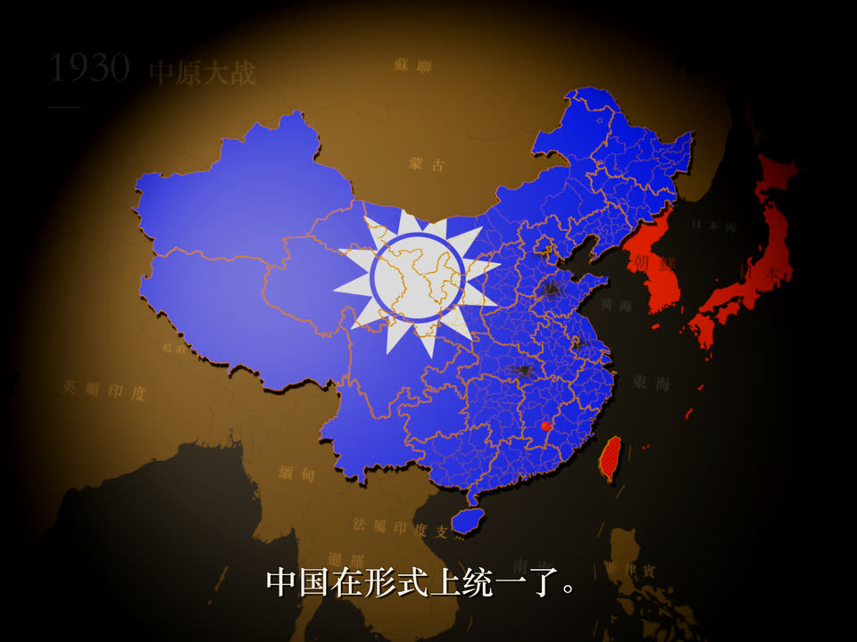
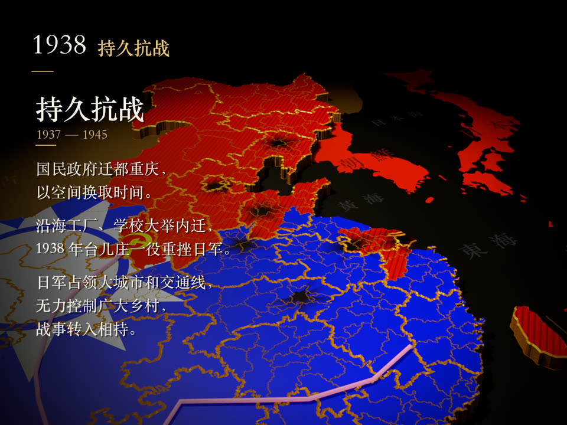
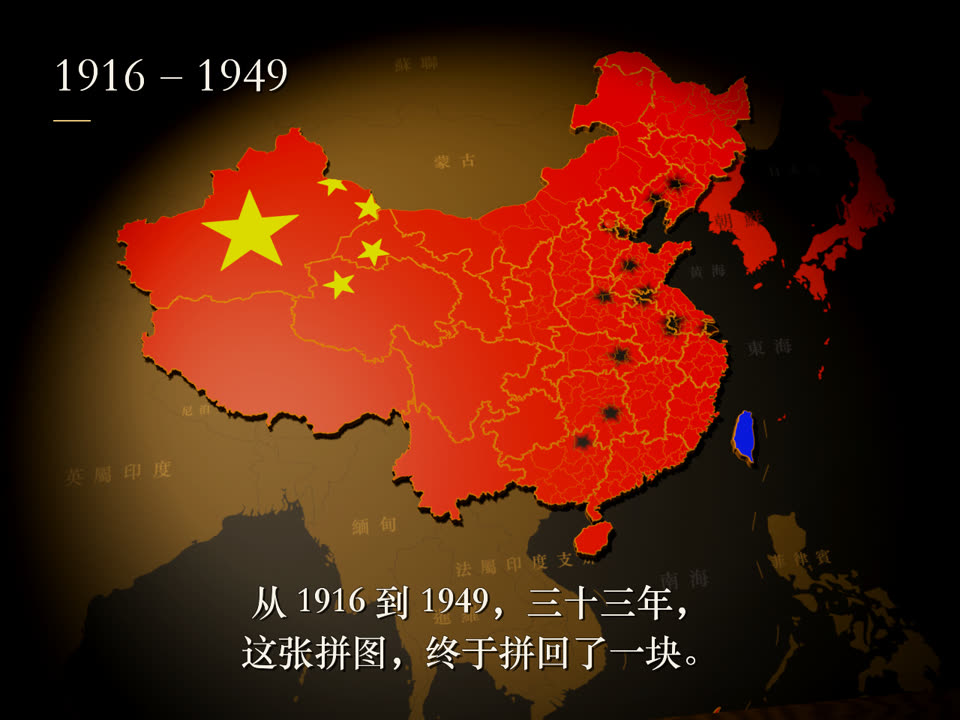
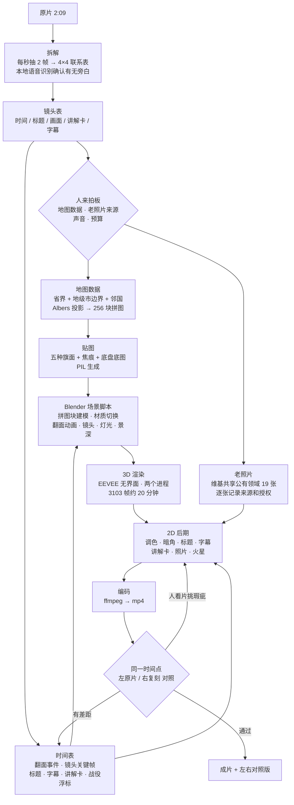

# 01 · 《中华民族的救亡图存》3D 拼图地图复刻

中文 | [English](README.en.md)

把一条 2 分 09 秒的 Blender 拼图地图历史视频，用 Claude Code 写代码的方式按镜头还原。

- 原片：<https://www.douyin.com/video/7703025441100337256>（2026-11-01 发布，720×540 横屏，40 多万赞）
- 原片的创意属于原作者：把地图做成一盒实体拼图；占一块、翻一块，背面拼成旗；镜头跟着前线推进。本期只复刻做法，画面设计和文案的著作权归原作者。
- 复刻结果：1280×960、24 fps、3103 帧、2:09。付费生成调用 0 次，全部在一台 Mac 上本地渲染。
- 提示词见 [PROMPTS.md](PROMPTS.md)。

| 北伐后形式统一 | 持久抗战（讲解卡） | 结尾 |
|---|---|---|
|  |  |  |

以上三张都是复刻版的画面。

## 动线图

核心是三件事：

1. **时间表是唯一的事实来源。** 3D 渲染和 2D 后期都读同一份时间表，改一处时间，两边一起变。
2. **3D 和 2D 分开。** Blender 只渲染拼图、镜头和灯光；所有文字、照片、调色都在后期用代码叠。改字幕不用重渲 3D。
3. **用对照图迭代，不凭感觉。** 每改一轮，取原片和复刻在同一秒的画面并排看。

## 制作过程

### 1. 拆解原片

- 把原片按每秒 2 帧抽出来，每 8 秒拼成一张 4×4 联系表，共 17 张。一张图就能看完 8 秒里镜头怎么动。
- 用本地语音识别跑一遍音轨，结论是：原片没有旁白，声音是一首英文歌加拼图落位的音效，信息全靠字幕。
- 据此写出镜头表，一共 22 段，每段记录：时间、左上角标题、画面内容、讲解卡和照片、底部字幕。
- 同时列出画面要素：木桌和木框托盘、带厚度的拼图块、五种势力贴面、翻面动作、焦痕、长征折线，以及后期叠加的标题、讲解卡、老照片、字幕、战役浮标。

### 2. 先让人拍板四件事

动手前一次问清楚，后面不再反复确认：

| 问题 | 这次的选择 |
|---|---|
| 地图边界用什么数据 | 阿里云 DataV 的省市边界，邻国用 Natural Earth |
| 原片要不要下载到本地 | 下载，只做研究对照，不进成片 |
| 老照片从哪来 | 维基共享的公有领域照片 |
| 声音怎么办 | 先做画面，声音后定 |

### 3. 地图 → 256 块拼图

- 省界之外，把 18 个交战和根据地所在的省再切到地级市，这样前线推进时能一小块一小块地翻。
- 统一用 Albers 等积圆锥投影（标准纬线 25°/47°，中央经线 105°E），1 个单位 = 500 公里。
- 边界做简化（约 1.5 公里精度），小于约 300 平方公里的小岛不单独成块。
- 邻国只保留轮廓，用来画底盘上的暗金色陆地。

### 4. 贴图

每种势力一整张大贴图，覆盖全中国；拼图块按自己的位置去取这张图的一部分，所以一枚大徽记能跨越多个省。

- 空白、北洋（五色横条 + 姓氏牌）、国民政府（蓝底大白日）、日占（红底斜纹）、中共（红底镰刀锤子）、结尾（五星红旗）
- 一张焦痕贴图：一个通道存深浅，一个通道存「第几秒出现」
- 一张底盘底图：暗金色邻国、近黑色海、描金省界和繁体地名

### 5. 时间表

一个文件写完全片的调度：

- 翻面事件：起止时间、翻成哪种势力、选中哪些块、从哪个经纬度向外扩散
- 镜头关键帧：时间、看向的经纬度、距离、俯仰角、方位角，外加 4 个硬切点
- 标题、字幕、8 张讲解卡（标题、起止年、段落、配的照片）、战役浮标、角落照片

选块用小的组合函数（某省、某几个市、并集、取反），写起来像「山东和河南，除了某几个市」。

### 6. Blender 场景脚本

- 每块拼图由轮廓生成网格：顶面略微内缩，露出一圈描金倒角，侧面是木色。
- 一个材质管所有块：五张旗面贴图都接在材质里，用每个物体自己的「物体颜色」的一个通道决定显示哪张，另一个通道传当前时间给焦痕做判断。
- 翻面：块体抬起、绕轴翻转、落下，各块按离扩散中心的距离错开时间。
- 聚光灯跟着镜头目标走；近景开景深；开运动模糊。
- 支持只渲染某几秒的静帧，也支持按帧范围渲染并跳过已有帧。

### 7. 渲染

EEVEE 无界面渲染，1280×960、12 采样，每帧 0.4–0.8 秒。把 3103 帧分成两半，两个进程同时跑，约 20 分钟。每帧同时导出战役地点在画面上的坐标，给后期定位浮标和火星用。

### 8. 2D 后期

用 PIL 逐帧叠加，多进程并行：

- 调色（提饱和、提对比、压亮度）和暗角
- 左上角年份和小标题、底部字幕
- 讲解卡：出现时画面压暗，先放照片，再从右侧滑入标题和正文，重点词金色
- 带白边、略微旋转的老照片和图注
- 战役浮标和落位时的金色火星

### 9. 对照和迭代

写了一个小脚本：给定几个时间点，把原片和复刻的同一秒并排拼成一张图。全片每 8 秒抽一个点过一遍，再对有差距的段落调时间表。

之后由人看成片挑瑕疵。这一期被指出的是 1:47 处少了一张「北平，部队入城」的照片，补上照片后只重做了那几秒的后期和编码，没有重渲 3D。

## 踩过的坑

| 现象 | 原因 | 解决 |
|---|---|---|
| 拼图块顶面缺一块、发黑 | 直接对内缩后的轮廓做三角剖分，会留缝，部分三角形朝向反了 | 用原始轮廓剖分，再套到内缩后的顶点上；每个三角形按实际顶点位置校正朝向 |
| 材质混合节点接错口 | 按名字连接，同名接口有好几个 | 改用序号连接 |
| 焦痕始终不出现 | 无界面渲染时，改节点里的数值不会逐帧生效 | 把时间放进物体颜色的一个通道里传给材质 |
| 运动模糊不对 | 模糊要取帧与帧之间的姿态 | 在「帧变化」回调里更新所有块的姿态 |
| Blender 渲染中途崩溃 | 偶发，另有程序也在用 Blender | 按帧范围渲染，跳过已有帧，外面套重试循环 |
| 叠加文字整体偏小 | 量尺寸时用错了缩放比例 | 回到原片截图上重新量，校了两轮 |
| 五星红旗的星位置不对 | 贴图坐标换算错 | 按旗面比例重新定位 |
| 维基共享接口限流（429） | 请求太密 | 每次间隔约 6 秒并重试 |

## 和原片还有的差距

- 镜头是手工关键帧，按每 0.5 秒对齐，没有逐帧吻合；全景镜头略远，个别位置原片已停稳而复刻还在移动。
- 焦痕偏淡，聚光灯外的蓝色比原片亮，描金接缝比原片密。
- 老照片不保证和原片是同一张；其中「南京受降」用的是会场外景，「红军集会」的照片内容没有核实。
- 势力范围按省和地级市近似，沿用原片的简化，史实细节没有逐条核对。

## 想自己做一遍需要什么

- Blender（本期用 5.2.2）、Python 3 + Pillow、ffmpeg
- 一个能读写文件、能跑命令的编程代理（本期用 Claude Code）
- 公开发布含中国地图的视频，需要符合标准地图的要求；用别人的作品做复刻，要注明出处。
