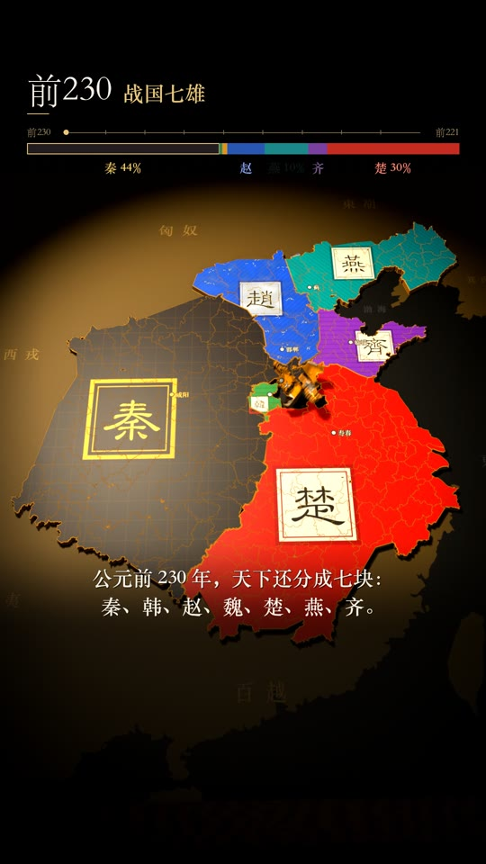
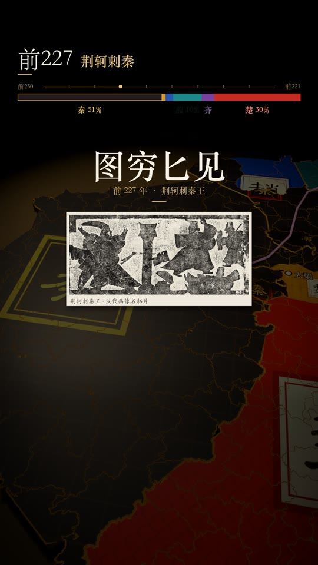
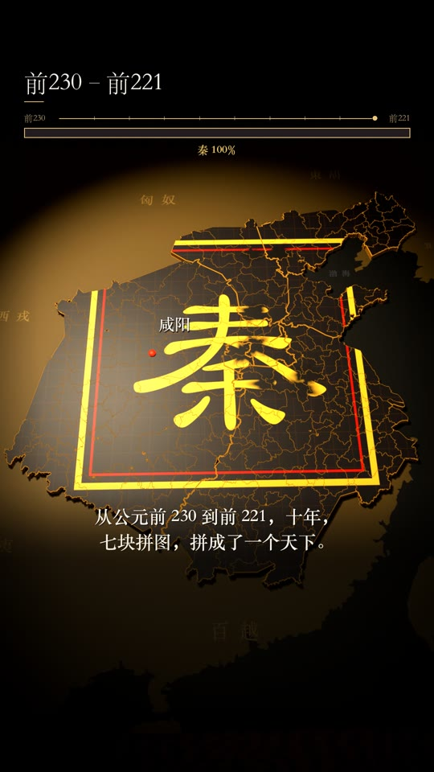
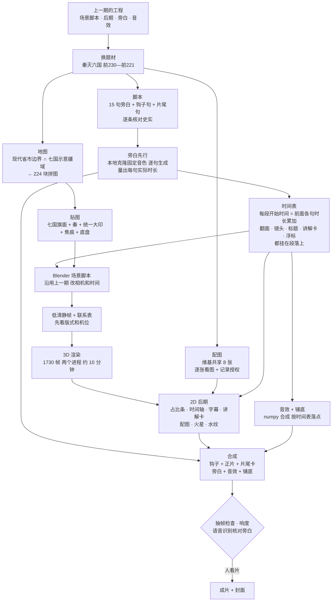

# 02 · 秦灭六国 3D 拼图地图（竖屏）

把第 01 期的拼图地图做法换一个题材重做：公元前 230 到前 221 年，秦十年灭六国。原生竖屏 1080×1920，80 秒，带旁白和节点音效。

- 拼图地图这个形式来自第 01 期复刻的原片《中华民族的救亡图存》（<https://www.douyin.com/video/7703025441100337256>），创意属于原作者。本期的题材、脚本、贴面设计和时间表是新写的。
- 结果：1080×1920、24 fps、80.3 秒（钩子 4.2 + 正片 72.1 + 片尾卡 4.0）。付费生成调用 0 次，全部在一台 Mac 上本地完成，从开工到成片约一小时。
- 提示词见 [PROMPTS.md](PROMPTS.md)。

| 开场：七国 | 图穷匕见 | 结尾：天下一统 |
|---|---|---|
|  |  |  |

## 动线图

和上一期最大的不同：**先出旁白，再排时间表**。上一期的时间是照着原片对的，旁白只能硬压语速去塞；这一期每句旁白念多久，那一段就多长，翻面、镜头、字幕都写成「某一段的百分之几处」，改一句台词，后面全部自动顺延。

## 制作过程

### 1. 脚本

15 句，每句只讲一件事，按时间顺序：七国并立 → 灭韩 → 李牧被杀 → 邯郸城破 → 荆轲刺秦 → 攻破蓟城 → 水淹大梁 → 李信兵败 → 王翦伐楚 → 楚亡 → 辽东和代 → 齐降 → 称始皇帝 → 收尾。

每条史实写之前核对出处，数字只用《史记》里有的（李信二十万、王翦六十万、水灌大梁三月、齐四十余年不受兵）。

### 2. 地图 → 224 块拼图

- 战国没有现成的行政区边界数据。做法是：手绘一份七国示意疆域（约前 231 年，按秦岭、太行、黄河、淮河等自然界线画多边形），再拿现代地级市边界去和它求交集。
- 一个地级市跨两国就切成两块；太小的碎片并入同一地级市里最大的那块，避免出现细条。
- 投影换成以 114°E 为中央经线，比例放大到 1 单位 = 240 公里，这样七国范围在场景里和上一期的全国范围差不多大，相机、厚度、灯光的参数都不用动。
- 底盘只画陆地和海，不画任何现代国界，周边写「匈奴」「东胡」「百越」这些古称。

### 3. 贴图

- 六国各一种底色和暗纹，中间一块米色隶书国名牌（韓、趙、魏、楚、燕、齊），都城一个白点。
- 秦是黑底金线方格。被吞并的土地翻成秦面，六国故地各有一块小的金字「秦」牌。
- 结尾全图翻成一方金色大印，一个「秦」字盖住整张地图。

### 4. 旁白先行

- 用上一期选定的音色做参考，本地克隆，逐句生成。
- 每句去掉首尾静音，句内超过 0.3 秒的停顿压到 0.3 秒，统一提速 1.12 倍。
- 把每句的实际时长写进一个文件，时间表读它。

### 5. 时间表

- 每段的开始时间 = 前面各句时长加上句间空隙的累加。
- 事件写成相对位置，例如「灭韩这句念到一半时，韩国的块开始翻」。
- 几个需要分阶段的地方用经纬度筛选：赵国先翻大部，代地留到前 222 年；燕国先翻蓟城一带，辽东留到前 222 年；楚地从北往南分三波。

### 6. 关键事件的处理

| 事件 | 画面 | 声音 |
|---|---|---|
| 开场点名 | 念到哪国，哪国的块原地翻一圈 | 木块声 |
| 荆轲刺秦 | 一条线从蓟城走到咸阳；随后全屏压暗，居中「图穷匕见」和汉代画像石拓片 | 低钟 + 低频持续音 + 匕首的金属声，铺底停下 |
| 水淹大梁 | 大梁上一圈圈往外漫的蓝色水纹，城破时翻面 | 水声渐强 |
| 李信兵败 | 楚地几块先翻成秦，又翻回楚 | 闷响 |
| 齐降 | 翻得慢、抬得低，没有火星 | 一声清钟 |
| 天下一统 | 从咸阳向外，整张图翻成大印 | 三下鼓，铺底转大调 |

### 7. 竖屏版式

抖音底部的文案会盖住画面下方约 28%。所以字幕和讲解卡全部放在上方 72% 以内，地图中心放在画面上半部；讲解卡出现时，相机把地图再往上让一点。

### 8. 渲染、后期、合成

和上一期一样：先渲低清静帧拼成联系表看版式，再两个进程渲全片；后期用 PIL 叠文字和配图；ffmpeg 合成。成片后抽帧检查、量响度，并用本地语音识别把旁白逐句转写一遍，核对有没有念错字。

## 踩过的坑

| 现象 | 原因 | 解决 |
|---|---|---|
| 渲染一开始每秒只有 0.5 帧 | 同时在跑本地语音合成，抢显卡 | 旁白和音轨先做完，再渲染 |
| 特写时主体跑到画面最上面 | 竖屏相机的垂直偏移量取大了 | 先出静帧联系表再调，不直接渲全片 |
| 讲解卡下半截会被平台文案盖住 | 上一期把讲解卡放在了画面下方 | 整套版式上移到上方 72% |
| 响度偏大、峰值顶到 0 dB | 合成后没留余量 | 限幅前降 2 dB，成片 -14.6 LUFS |
| 封面上传后被换回视频截图 | 平台切到横封面时会重新同步竖封面 | 横封面传完，再回头把竖封面重传一次 |
| 小号语音识别模型核对不了人名地名 | 同音字多 | 只核对读音，剩下拿不准的两处让人听一遍 |

## 口径和局限

- 七国疆域是手绘示意，不是精确史图；拼图块沿用现代地级市边界，海岸线是现代的。
- 占比条按拼图面积算，不是史实上的精确面积。
- 楚地分三波翻完都放在「楚亡」一段，没有单独讲前 222 年平定江南。
- 配图来自维基共享，公有领域、CC0 或 CC BY；其中兵马俑照片为 CC BY 2.0（摄影 shankar s.）。荆轲刺秦那张拓片的出处页面没有写明是哪座祠堂，图注只写「汉代画像石拓片」。
- 旁白是 AI 合成。

## 想自己做一遍需要什么

- Blender（本期用 5.2.2）、Python 3 + Pillow + shapely、ffmpeg
- 一个本地语音合成引擎（本期用 Breeze TTS 的 MLX 版）
- 一个能读写文件、能跑命令的编程代理（本期用 Claude Code）
- 渲染工程源码不在本仓库，见仓库首页的说明。
